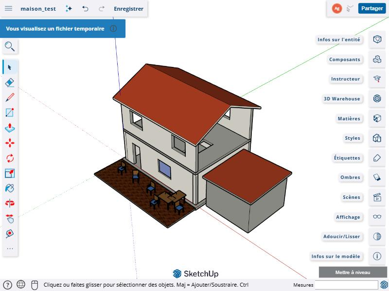
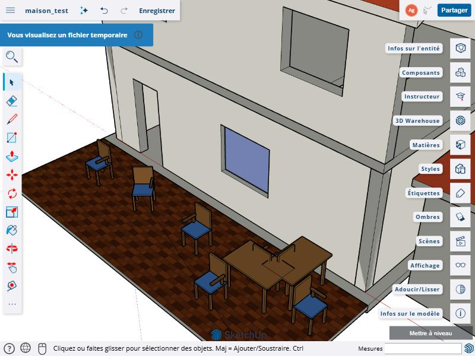
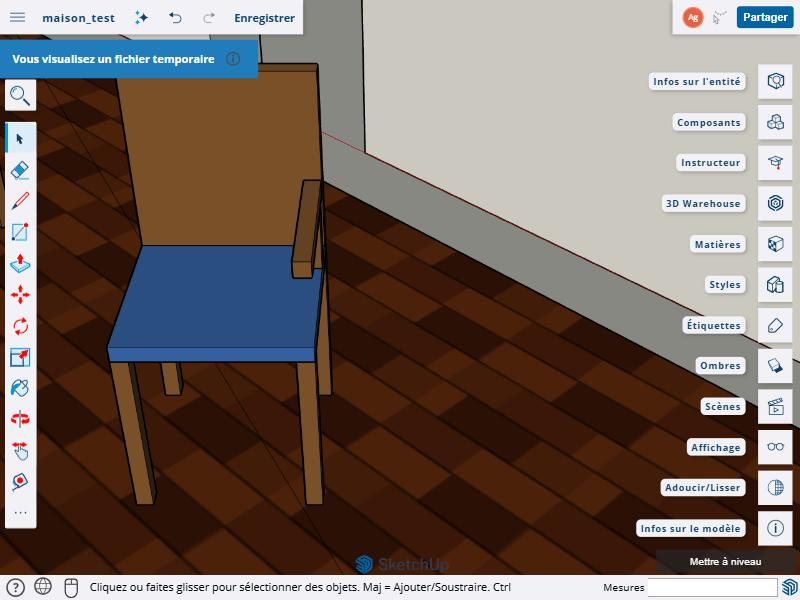

# Arkedia SKP Bridge

**Importez et exportez des fichiers SketchUp (.skp) dans Blender, sans installer SketchUp.**

Page du projet : [arkedia3d.github.io/arkedia-skp-bridge](https://arkedia3d.github.io/arkedia-skp-bridge/)


| Dans Blender, après import | Dans SketchUp pour le web, après export |
|---|---|
|  |  |

Arkedia SKP Bridge ouvre un fichier .skp dans Blender et écrit un .skp que SketchUp ouvre sans réparation. Pas de
SketchUp à installer, pas de détour par l'OBJ ou l'IFC. L'extension tourne sur Blender 5.2 LTS, sous Windows
64 bits. Elle est déclarée compatible avec Blender 5.1, qui embarque le même Python 3.13, mais nous ne l'avons
essayée que sur la 5.2.3.

ARKEDIA 3D l'a développée pour son flux de relevé LiDAR vers la CAO et le BIM : nuage de points (E57, PLY),
modélisation dans Blender avec Bonsai (IFC), puis livraison dans le format que le client ouvre tous les jours.
Elle est gratuite et libre (GPL-3.0 ou ultérieure).

## Ce qu'elle fait

**À l'import**, un composant placé mille fois dans SketchUp devient mille objets Blender qui partagent le même
maillage. Le fichier reste léger, et chaque copie peut toujours être convertie en IFC, exportée ou éditée. Les
étiquettes SketchUp deviennent des collections, les scènes deviennent des caméras, les groupes gardent leur
hiérarchie. Les matériaux gardent leur nom et leurs textures, les couleurs sont converties en linéaire, et les GUID
et attributs SketchUp restent lisibles dans les propriétés personnalisées (`skp_*`).

**À l'export**, les maillages partagés deviennent des composants, les collections (ou les niveaux IFC, ou les
classes IFC) deviennent des calques, et les triangles coplanaires sont fusionnés en une seule face avec ses trous.
Un mur percé de fenêtres ou une dalle trouée s'ouvrent dans SketchUp sans diagonales de triangulation. Quand le
projet vient de Bonsai, la classe IFC, le GlobalId, le nom et les jeux de propriétés passent dans les attributs
SketchUp. Le fichier s'ouvre sur une vue d'ensemble cadrée sur le modèle, pas sur un coin vide près de l'origine.

L'extension fonctionne dans un Blender dont l'interface est en français : elle ne cherche jamais un nœud de shader
par son nom (traduit), seulement par son type.

## Installation

Il faut Blender 5.2 LTS (ou 5.1, non testé) sous Windows 64 bits. Le zip contient ses bibliothèques (openskp, shapely,
mapbox_earcut, defusedxml) : aucune installation de Python ni connexion supplémentaire n'est nécessaire.

### Par le dépôt d'extensions (mises à jour automatiques)

Dans Blender, ouvrir Édition > Préférences > Obtenir des extensions (Get Extensions). En haut de la fenêtre,
cliquer sur « Dépôts » (Repositories), puis sur le bouton « + » et choisir « Ajouter un dépôt distant »
(Add Remote Repository). Coller l'adresse :

```
https://arkedia3d.github.io/arkedia-skp-bridge/extensions/index.json
```

Un dépôt distant demande l'accès en ligne : Blender propose de l'autoriser (réglage « Autoriser l'accès en ligne »
dans Préférences > Système > Réseau). « Arkedia SKP Bridge » apparaît ensuite dans la liste : un clic sur Installer.

### Par le fichier zip

Télécharger `arkedia_skp_bridge-0.2.0.zip` sur la [page du projet](https://arkedia3d.github.io/arkedia-skp-bridge/#installation)
ou dans les [Releases](../../releases) de ce dépôt, puis dans
Préférences > Obtenir des extensions, ouvrir le menu déroulant en haut à droite et choisir « Install from Disk »
(Blender ne traduit pas ce libellé). On peut aussi faire glisser le zip sur la fenêtre de Blender. Ce chemin ne
demande pas d'accès en ligne.

### Vérifier

Fichier > Importer et Fichier > Exporter proposent maintenant « SketchUp Arkedia (.skp) ».
Un fichier d'exemple, la maison d'essai du README, est dans [`exemples/maison_test.skp`](exemples/maison_test.skp).

## Utilisation

### Importer

Fichier > Importer > SketchUp Arkedia (.skp).

| Option | Effet |
|---|---|
| Conserver la hiérarchie des groupes | Les groupes SketchUp deviennent des parents Blender (actif par défaut) |
| Scènes SketchUp en caméras | Chaque scène devient une caméra (actif par défaut) |
| Conserver GUID et attributs | Écrits en propriétés personnalisées `skp_guid`, `skp_layer`, `skp_attributes`… (actif par défaut) |
| Ignorer les faces arrière dupliquées | Évite de doubler la géométrie quand le dos d'une face n'a pas la couleur de son recto (actif par défaut) |
| Ignorer la vérification de mémoire | Importe même si la mémoire disponible semble trop juste pour ce fichier |

Avant d'importer, l'extension estime la mémoire nécessaire. Si elle dépasse ce qui est disponible, l'import est
refusé avec un message clair au lieu de figer l'ordinateur : un fichier de 85 Mo refuse de s'ouvrir quand il reste
4 Go de mémoire libre, et passe sans problème avec 8 Go.

### Exporter

Fichier > Exporter > SketchUp Arkedia (.skp). Sans sélection, toute la scène visible est exportée.

| Option | Effet |
|---|---|
| Sélection uniquement | Sinon, tout ce qui est visible (actif par défaut) |
| Maillages partagés en composants | Les objets qui partagent un maillage deviennent un composant et ses instances (actif) |
| Appliquer les modificateurs | Exporte le résultat évalué (actif) |
| Calques SketchUp | Collection Blender (défaut), niveau IFC, classe IFC ou aucun |
| Textures image | Écrit les textures des matériaux (actif) |
| Attributs (classe, GlobalId, nom IFC) | Dictionnaire d'attributs « ARKEDIA » sur chaque objet, avec les propriétés personnalisées en `custom_*` (actif) |
| Jeux de propriétés IFC | Un dictionnaire `IFC_<jeu>` par jeu de propriétés Bonsai (actif) |
| Fusionner les triangles coplanaires | Une face SketchUp par surface plane, trous compris (actif) |
| Vue enregistrée | Perspective cadrée (défaut), isométrique cadrée, ou la vue fixe d'openskp |

Les objets de type crayon gras, volume, nuage de points et cheveux ne sont pas exportés : l'export en signale le
nombre dans les avertissements.

### En script

```python
import bpy

# Importer
bpy.ops.import_scene.arkedia_skp(filepath=r"C:\modeles\maison.skp")

# Exporter toute la scène visible, un calque par niveau IFC
bpy.ops.export_scene.arkedia_skp(
    filepath=r"C:\livraisons\maison.skp",
    only_selected=False,
    layer_mode="IFC_STOREY",
)
```

Pour récupérer les statistiques (faces, composants, avertissements), on appelle directement les fonctions du module,
qui renvoient un dictionnaire :

```python
import sys
import bpy

module = next(m for nom, m in sys.modules.items()
              if nom.startswith("bl_ext.") and nom.endswith(".arkedia_skp_bridge"))

stats = module.export_skp(r"C:\livraisons\maison.skp", bpy.context, only_selected=False)
print(stats["faces"], stats["components"], stats["warnings"])

stats = module.import_skp(r"C:\modeles\maison.skp", bpy.context)
print(stats["objects"], stats["seconds"])
```

## Performances

Mesures prises en arrière-plan sur un portable Intel Core i7-11800H (8 cœurs), 15,6 Go de mémoire, Windows 11,
Blender 5.2.3 LTS. L'export part d'une scène Blender, l'import relit le fichier produit. La mémoire est le pic de
mémoire engagée par le processus Blender pendant l'import, démarrage de Blender compris (0,26 Go à vide).

| Modèle | Fichier .skp | Export | Import | Mémoire à l'import |
|---|---:|---:|---:|---:|
| Maison d'essai (20 objets, 3 composants, 1 texture) | 83 Ko | 1,0 s | 0,1 s | 0,3 Go |
| 2 000 murs, 8 matériaux | 4,0 Mo | 6,0 s | 2,9 s | 0,37 Go |
| 20 000 murs, 20 000 groupes distincts | 41,2 Mo | 49,4 s | 29,3 s | 1,36 Go |
| 30 000 chaises, un seul composant | 9,5 Mo | 3,7 s | 4,1 s | 0,50 Go |
| 100 000 chaises, un seul composant | 31,6 Mo | 10,7 s | 14,3 s | 1,09 Go |
| Dalle plane de 180 000 triangles (une seule face) | 7 Ko | 12,1 s | moins de 0,1 s | 0,26 Go |
| Terrain bruité de 180 000 triangles | 30,5 Mo | 10,3 s | 17,8 s | 1,26 Go |
| Sphère de 327 680 triangles | 56,0 Mo | 17,5 s | 31,0 s | 1,97 Go |
| Terrain bruité de 500 000 triangles | 85,1 Mo | 27,2 s | 49,1 s | 2,88 Go |
| 10 plans texturés (images de bruit de 1 024 et 2 048 pixels) | 56,1 Mo | 4,5 s | 0,7 s | 0,44 Go |

Les 100 000 chaises tiennent dans un seul composant : c'est le cas courant d'un chantier meublé ou d'un site
répétitif. Les 20 000 murs sont 20 000 groupes différents, le cas le plus lourd pour le format. La dalle plane de
180 000 triangles devient une seule face, d'où ses 7 Ko. Le terrain bruité n'a aucune surface plane à fusionner :
chaque triangle devient une face, ce qui en fait le plus gros fichier de la série. Les 56 Mo des plans texturés
viennent des images de bruit, qui ne se compressent pas.

Pour un fichier riche en géométrie, il faut compter de l'ordre de 30 fois la taille du fichier en mémoire à
l'import. Le temps d'import est dominé par la lecture du format en Python pur (la bibliothèque openskp) : entre 0,4
et 0,7 seconde par mégaoctet de géométrie.

## Fidélité

Chaque cas de charge construit une scène, mesure sa surface totale, son volume, sa boîte englobante et son nombre
de triangles, exporte en .skp, relit le fichier dans un second processus Blender et compare. Sur les 17 cas,
la surface relue est égale à l'originale à 1e-7 près (écart maximal mesuré : 6e-8) et la boîte englobante est
identique au dixième de millimètre. Le modèle relu, réexporté puis relu une deuxième fois reste identique :
l'aller-retour ne dérive pas.

Sur la maison d'essai, chaque unité (mur, dalle, toiture, vitrage, chaise normale, tournée et en miroir…) est
comparée une à une avec son original : centre de surface, aire, volume, boîte englobante. Les 20 unités sont
retrouvées à un micromètre près. Le contrôle unité par unité compte : un accoudoir de chaise du mauvais côté (un
miroir mal rendu) laisse la surface et le volume totaux inchangés.

Les cas de charge couvrent aussi les situations qui cassent d'ordinaire un exporteur : faces dégénérées, sommets
confondus, quadrilatères gauchis, trois faces sur une même arête, échelles négatives, parentés à cisaillement, objet
à 6 700 km de l'origine, scène en millimètres, modificateurs, noms accentués, japonais, emoji ou de 300 caractères,
propriétés personnalisées très longues, collections instanciées.

La maison d'essai exportée a été ouverte dans SketchUp pour le web et examinée à l'écran : matériaux, textures,
calques, composants (vitrages, chaises), toit et murs sans diagonales.

| La terrasse et ses chaises | Une chaise de près |
|---|---|
|  |  |

## Les essais

Les scripts sont dans [`tests/`](tests/) et tournent sans interface, avec un profil Blender jetable pour ne pas
toucher à vos réglages. Le mode d'emploi est dans [`tests/README.md`](tests/README.md). Un exemple :

```
python tests\driver.py resultats 4 degenerate transforms boxes:2000+ inst:30000+ sphere:6+
python tests\summarize.py resultats
```

## Limites connues

- Windows 64 bits seulement pour l'instant. Les bibliothèques compilées jointes (shapely, mapbox_earcut) sont celles
  de Windows et de Python 3.13, la version de Blender 5.1 et 5.2. Un portage Linux ou macOS demande d'ajouter les
  roues correspondantes au dossier `wheels/` et de compléter `platforms` dans le manifeste.
- Les surfaces texturées gardent leur triangulation : les diagonales y restent visibles dans SketchUp. Les surfaces
  unies, elles, sont fusionnées.
- Une collection instanciée dans Blender s'exporte comme un seul composant (tous ses objets réunis dans la
  définition), pas comme une hiérarchie de sous-composants.
- Les nuages de points, volumes, crayons gras et cheveux ne s'exportent pas. Les courbes, textes, surfaces NURBS
  et métaballes sont exportés sous forme de maillage évalué.
- L'import de très gros fichiers coûte de la mémoire (voir plus haut), et supprimer ensuite des centaines de
  milliers d'objets est lent : c'est le comportement de Blender.
- Les gros fichiers du banc de charge (jusqu'à 85 Mo) ont été relus dans Blender, pas dans SketchUp. Leur confort
  d'affichage dans SketchUp reste à vérifier.
- Les fichiers écrits sont au format SketchUp 2017, que les versions plus récentes savent ouvrir. L'ouverture a
  été vérifiée dans SketchUp pour le web, pas encore dans SketchUp Desktop.
- La lecture des fichiers SketchUp 2021 et suivants (nouveau conteneur) repose sur openskp. Nos essais ont porté sur
  des fichiers produits par l'extension et sur des fichiers enregistrés par SketchUp en version 26.1.

## Crédits et licence

Le format .skp est lu et écrit par [openskp](https://github.com/iamahsanmehmood/openskp) d'Ahsan Mehmood (licence
MIT), reconstitué sans le SDK de Trimble. L'extension s'inspire de deux projets existants dont nous avons étudié le
code : OpenSKP Import/Export (instanciation réelle des composants, calques, arêtes seules) et Sketchup_Importer de
RedHaloStudio (noms de matériaux, conversion sRGB, hiérarchie, scènes). Les fusions de faces s'appuient sur
[shapely](https://github.com/shapely/shapely) et [mapbox_earcut](https://github.com/skogler/mapbox_earcut_python),
la lecture XML sur [defusedxml](https://github.com/tiran/defusedxml). Leurs licences sont dans les roues du dossier
`arkedia_skp_bridge/wheels/`.

Arkedia SKP Bridge est distribué sous licence GPL-3.0 ou ultérieure (voir [`LICENSE`](LICENSE)). SketchUp est une
marque de Trimble Inc. Ce projet n'est ni affilié à Trimble ni approuvé par elle.

## À propos

ARKEDIA 3D est la première agence de numérisation LiDAR 16K et de visites virtuelles en Côte d'Ivoire. Pour toute
question sur l'extension ou sur nos relevés et nos maquettes : contact@arkedia3d.ci, https://www.arkedia3d.ci.
Les signalements de défauts et les demandes d'amélioration passent par les [Issues](../../issues) du dépôt.
