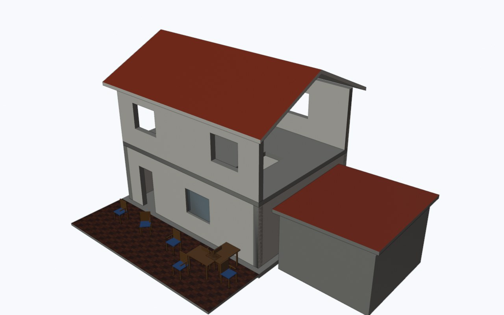
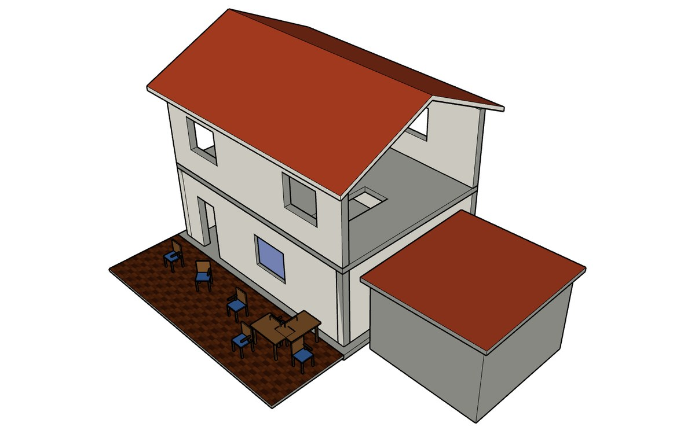
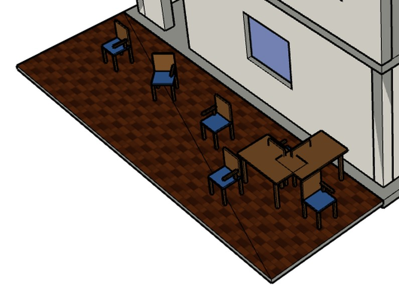
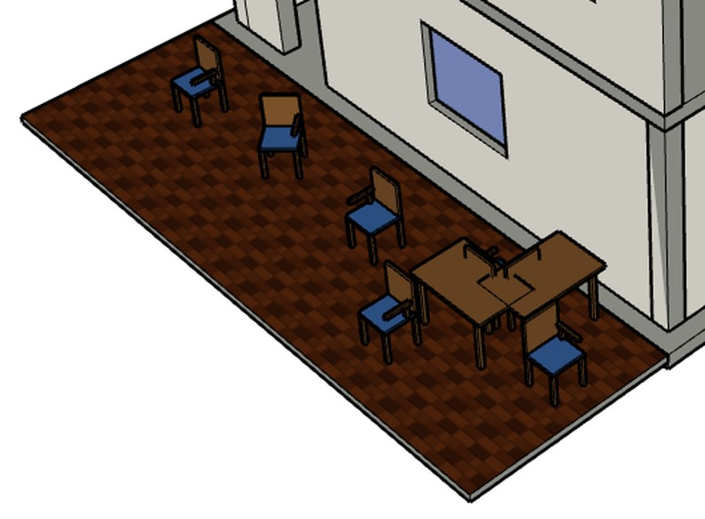
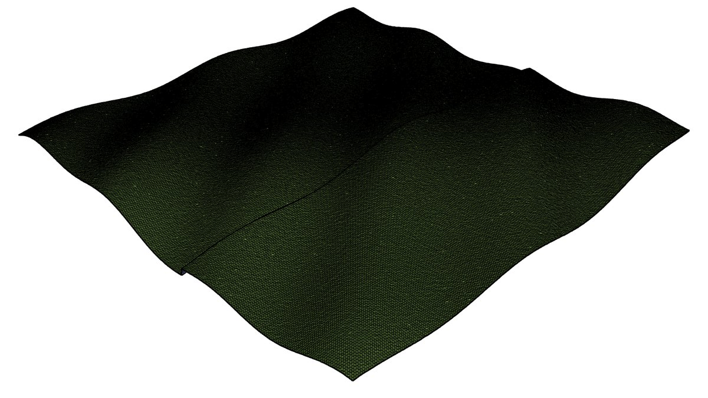
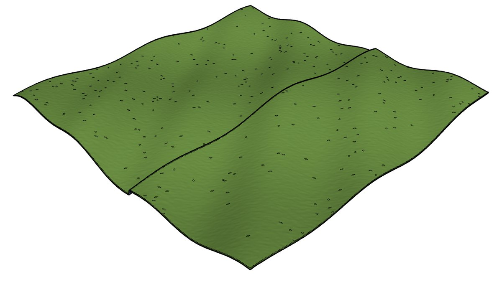

# Arkedia SKP Bridge

**Importez et exportez des fichiers SketchUp (.skp) dans Blender, sans installer SketchUp.**

Page du projet : [arkedia3d.github.io/arkedia-skp-bridge](https://arkedia3d.github.io/arkedia-skp-bridge/)


| Dans Blender, après import | Dans SketchUp 2027, après export |
|---|---|
|  |  |

Arkedia SKP Bridge ouvre un fichier .skp dans Blender et écrit un .skp que SketchUp ouvre sans réparation, dans sa
version de bureau (essais sur SketchUp 2027) comme dans sa version web. Pas de SketchUp à installer pour s'en servir,
pas de détour par l'OBJ ou l'IFC. L'extension tourne sur Blender 5.2 LTS, sous Windows 64 bits. Elle est déclarée
compatible avec Blender 5.1, qui embarque le même Python 3.13, mais nous ne l'avons essayée que sur la 5.2.3.

ARKEDIA 3D l'a développée pour son flux de relevé LiDAR vers la CAO et le BIM : nuage de points (E57, PLY),
modélisation dans Blender avec Bonsai (IFC), puis livraison dans le format que le client ouvre tous les jours.
Elle est gratuite et libre (GPL-3.0 ou ultérieure).

## Ce qu'elle fait

**À l'import**, un composant placé mille fois dans SketchUp devient mille objets Blender qui partagent le même
maillage. Le fichier reste léger, et chaque copie peut toujours être convertie en IFC, exportée ou éditée. Les
étiquettes SketchUp deviennent des collections, les scènes deviennent des caméras, les groupes gardent leur
hiérarchie. Les matériaux gardent leur nom et leurs textures, les couleurs sont converties en linéaire, et les GUID
et attributs SketchUp restent lisibles dans les propriétés personnalisées (`skp_*`).

**À l'export**, les maillages partagés deviennent des composants, les collections (ou les niveaux IFC, chacun sous
son nom, ou les classes IFC) deviennent des calques, et les triangles coplanaires sont fusionnés en une seule face avec ses trous.
Un mur percé de fenêtres, une dalle trouée ou un sol carrelé s'ouvrent dans SketchUp sans diagonales de
triangulation. Un terrain ou un maillage issu d'un scan reçoit des arêtes douces et s'affiche ombré au lieu de noir.
Les longueurs s'affichent dans l'unité de la scène Blender (2,80 m au lieu de 9' 2 1/4"). Quand le projet vient de
Bonsai, la classe IFC, le GlobalId, le nom, le niveau et les jeux de propriétés passent dans les attributs SketchUp,
et les pièces (IfcSpace) peuvent partir aussi : translucides, nommées avec leur surface (« Pièce 01 Chambre,
28,38 m² »), rentrées de 5 mm pour ne pas scintiller avec les sols et les murs, sur une étiquette par niveau
masquée à l'ouverture. Le fichier s'ouvre sur une vue d'ensemble cadrée sur le modèle, pas sur un coin vide
près de l'origine.

L'extension fonctionne dans un Blender dont l'interface est en français : elle ne cherche jamais un nœud de shader
par son nom (traduit), seulement par son type.

## Installation

Il faut Blender 5.2 LTS (ou 5.1, non testé) sous Windows 64 bits. Le zip contient ses bibliothèques (openskp, shapely,
mapbox_earcut, defusedxml) : aucune installation de Python ni connexion supplémentaire n'est nécessaire.

### Par le dépôt d'extensions (mises à jour automatiques)

Dans Blender, ouvrir Édition > Préférences > Obtenir des extensions (Get Extensions). En haut de la fenêtre,
cliquer sur « Dépôts » (Repositories), puis sur le bouton « + » et choisir « Ajouter un dépôt distant »
(Add Remote Repository). Coller l'adresse :

```
https://arkedia3d.github.io/arkedia-skp-bridge/extensions/index.json
```

Un dépôt distant demande l'accès en ligne : Blender propose de l'autoriser (réglage « Autoriser l'accès en ligne »
dans Préférences > Système > Réseau). « Arkedia SKP Bridge » apparaît ensuite dans la liste : un clic sur Installer.

### Par le fichier zip

Télécharger `arkedia_skp_bridge-0.3.1.zip` sur la [page du projet](https://arkedia3d.github.io/arkedia-skp-bridge/#installation)
ou dans les [Releases](../../releases) de ce dépôt, puis dans
Préférences > Obtenir des extensions, ouvrir le menu déroulant en haut à droite et choisir « Install from Disk »
(Blender ne traduit pas ce libellé). On peut aussi faire glisser le zip sur la fenêtre de Blender. Ce chemin ne
demande pas d'accès en ligne.

### Vérifier

Fichier > Importer et Fichier > Exporter proposent maintenant « SketchUp Arkedia (.skp) ».
Un fichier d'exemple, la maison d'essai du README, est dans [`exemples/maison_test.skp`](exemples/maison_test.skp).

## Utilisation

### Importer

Fichier > Importer > SketchUp Arkedia (.skp).

| Option | Effet |
|---|---|
| Conserver la hiérarchie des groupes | Les groupes SketchUp deviennent des parents Blender (actif par défaut) |
| Scènes SketchUp en caméras | Chaque scène devient une caméra (actif par défaut) |
| Conserver GUID et attributs | Écrits en propriétés personnalisées `skp_guid`, `skp_layer`, `skp_attributes`… (actif par défaut) |
| Ignorer les faces arrière dupliquées | Évite de doubler la géométrie quand le dos d'une face n'a pas la couleur de son recto (actif par défaut) |
| Ignorer la vérification de mémoire | Importe même si la mémoire disponible semble trop juste pour ce fichier |

Avant d'importer, l'extension estime la mémoire nécessaire. Si elle dépasse ce qui est disponible, l'import est
refusé avec un message clair au lieu de figer l'ordinateur : un fichier de 85 Mo refuse de s'ouvrir quand il reste
4 Go de mémoire libre, et passe sans problème avec 8 Go.

### Exporter

Fichier > Exporter > SketchUp Arkedia (.skp). Sans sélection, toute la scène visible est exportée.

| Option | Effet |
|---|---|
| Sélection uniquement | Sinon, tout ce qui est visible (actif par défaut) |
| Maillages partagés en composants | Les objets qui partagent un maillage deviennent un composant et ses instances (actif) |
| Appliquer les modificateurs | Exporte le résultat évalué (actif) |
| Calques SketchUp | Collection Blender (défaut), niveau IFC (une étiquette au nom de chaque niveau ; avec les scènes, plafonds et toitures à part : « Plafonds - 1er étage », « Toiture - 2e étage »), classe IFC ou aucun |
| Textures image | Écrit les textures des matériaux (actif) |
| Attributs (classe, GlobalId, nom IFC) | Dictionnaire d'attributs « ARKEDIA » sur chaque objet, avec les propriétés personnalisées en `custom_*` (actif) |
| Jeux de propriétés IFC | Un dictionnaire `IFC_<jeu>` par jeu de propriétés Bonsai (actif) |
| Pièces (IfcSpace) | Exporte aussi les volumes de pièces d'un projet Bonsai, même masqués : translucides, nommés « Pièce 01 Chambre, 28,38 m² », sur une étiquette par niveau, « Pièces - Rez-de-chaussée » par exemple. Avec « Sélection uniquement », les pièces sélectionnées et celles des niveaux de la sélection (inactif) |
| Étiquette des pièces masquée à l'ouverture | Les pièces sont dans le fichier, leur étiquette est décochée ; un clic dans SketchUp les affiche (actif) |
| Retrait des pièces (mm) | Rentre les faces de chaque pièce de cette distance, 5 mm par défaut. Sans retrait, elles tombent sur les sols, les plafonds et les murs, et SketchUp les fait scintiller (moirage). 0 : volumes exacts |
| Surface dans le nom des pièces | Ajoute au nom la surface de l'IFC (NetFloorArea), mesurée avant le retrait : « Pièce 01 Chambre, 28,38 m² » (actif) |
| Noms des pièces en texte | Un texte SketchUp dans chaque pièce, son nom et sa surface sur deux lignes, au point le plus éloigné des murs. Il suit l'étiquette de la pièce et se lit dans les scènes « Plan » (actif) |
| Scènes par niveau | Avec « Niveau IFC » : « Vue d'ensemble », puis pour chaque niveau une vue « 3D » en maison de poupée (niveaux supérieurs, plafonds et toiture masqués) et une vue « Plan » de dessus avec ses pièces et leurs noms, par exemple « 3D - 1er étage » et « Plan - 1er étage » (actif) |
| Matière au verso des faces | Le verso de chaque face prend la matière du recto. Sans cela, SketchUp montre sa couleur de face arrière, un bleu-violet, au travers des vitrages et des pièces translucides (actif) |
| Fusionner les triangles coplanaires | Une face SketchUp par surface plane, trous compris. Une surface texturée est fusionnée quand sa texture se déroule d'un seul tenant (actif) |
| Adoucir les arêtes presque coplanaires | Arête douce et lisse entre deux faces voisines de même matériau à moins de 1 degré l'une de l'autre, quel que soit le nombre de faces : un mur de biais ou une face recalculée par l'IFC ne montre plus de traits parasites. Les arêtes réelles restent visibles (actif) |
| Adoucir les maillages denses | Arêtes douces entre faces voisines pour les objets de 2 000 faces et plus (terrain, maillage de scan). Sans elles, SketchUp trace chaque arête et le maillage paraît noir (actif) |
| Angle d'adoucissement | 35 degrés par défaut. À relever (50 à 60) si un maillage bruité garde des arêtes noires parsemées |
| Unités dans SketchUp | Comme la scène Blender (défaut), mètres, centimètres, millimètres ou pouces. Surfaces en m² |
| Vue enregistrée | Perspective cadrée (défaut), isométrique cadrée, ou la vue fixe d'openskp |

Les objets de type crayon gras, volume, nuage de points et cheveux ne sont pas exportés : l'export en signale le
nombre dans les avertissements.

### En script

```python
import bpy

# Importer
bpy.ops.import_scene.arkedia_skp(filepath=r"C:\modeles\maison.skp")

# Exporter toute la scène visible, un calque par niveau IFC
bpy.ops.export_scene.arkedia_skp(
    filepath=r"C:\livraisons\maison.skp",
    only_selected=False,
    layer_mode="IFC_STOREY",
)

# La même chose avec les pièces (étiquettes masquées à l'ouverture, noms en texte) et les scènes par niveau
bpy.ops.export_scene.arkedia_skp(
    filepath=r"C:\livraisons\maison_pieces.skp",
    only_selected=False,
    layer_mode="IFC_STOREY",
    export_spaces=True,
)
```

Pour récupérer les statistiques (faces, composants, avertissements), on appelle directement les fonctions du module,
qui renvoient un dictionnaire :

```python
import sys
import bpy

module = next(m for nom, m in sys.modules.items()
              if nom.startswith("bl_ext.") and nom.endswith(".arkedia_skp_bridge"))

stats = module.export_skp(r"C:\livraisons\maison.skp", bpy.context, only_selected=False)
print(stats["faces"], stats["components"], stats["warnings"])

stats = module.import_skp(r"C:\modeles\maison.skp", bpy.context)
print(stats["objects"], stats["seconds"])
```

## Performances

Mesures prises en arrière-plan sur un portable Intel Core i7-11800H (8 cœurs), 15,6 Go de mémoire, Windows 11,
Blender 5.2.3 LTS, avec la version 0.2.0, le matin du 27 octobre. L'export part d'une scène Blender, l'import relit
le fichier produit. La mémoire est le pic de mémoire engagée par le processus Blender pendant l'import, démarrage de
Blender compris (0,26 Go à vide).

| Modèle | Fichier .skp | Export | Import | Mémoire à l'import |
|---|---:|---:|---:|---:|
| Maison d'essai (20 objets, 3 composants, 1 texture) | 83 Ko | 1,0 s | 0,1 s | 0,3 Go |
| 2 000 murs, 8 matériaux | 4,0 Mo | 6,0 s | 2,9 s | 0,37 Go |
| 20 000 murs, 20 000 groupes distincts | 41,2 Mo | 49,4 s | 29,3 s | 1,36 Go |
| 30 000 chaises, un seul composant | 9,5 Mo | 3,7 s | 4,1 s | 0,50 Go |
| 100 000 chaises, un seul composant | 31,6 Mo | 10,7 s | 14,3 s | 1,09 Go |
| Dalle plane de 180 000 triangles (une seule face) | 7 Ko | 12,1 s | moins de 0,1 s | 0,26 Go |
| Terrain bruité de 180 000 triangles | 30,5 Mo | 10,3 s | 17,8 s | 1,26 Go |
| Sphère de 327 680 triangles | 56,0 Mo | 17,5 s | 31,0 s | 1,97 Go |
| Terrain bruité de 500 000 triangles | 85,1 Mo | 27,2 s | 49,1 s | 2,88 Go |
| 10 plans texturés (images de bruit de 1 024 et 2 048 pixels) | 56,1 Mo | 4,5 s | 0,7 s | 0,44 Go |

Les 100 000 chaises tiennent dans un seul composant : c'est le cas courant d'un chantier meublé ou d'un site
répétitif. Les 20 000 murs sont 20 000 groupes différents, le cas le plus lourd pour le format. La dalle plane de
180 000 triangles devient une seule face, d'où ses 7 Ko. Le terrain bruité n'a aucune surface plane à fusionner :
chaque triangle devient une face, ce qui en fait le plus gros fichier de la série. Les 56 Mo des plans texturés
viennent des images de bruit, qui ne se compressent pas.

Pour un fichier riche en géométrie, il faut compter de l'ordre de 30 fois la taille du fichier en mémoire à
l'import. Le temps d'import est dominé par la lecture du format en Python pur (la bibliothèque openskp) : entre 0,4
et 0,7 seconde par mégaoctet de géométrie.

La 0.2.1 va aussi vite que la 0.2.0. Nous avons fait tourner les deux l'une après l'autre sur la même machine, avec
trois cas (terrain de 180 000 triangles, sphère de 327 680, terrain de 500 000) : les temps diffèrent de 3 % au
plus (export du terrain de 500 000 triangles : 39,4 s en 0.2.0, 40,1 s en 0.2.1). Les temps absolus, eux, suivent la
charge de la machine : l'après-midi, avec d'autres programmes ouverts, ces mêmes cas ont pris 35 à 45 % de plus que
le matin, avec un code identique. Le tableau donne un ordre de grandeur, pas une garantie.

### Dans SketchUp 2027

Les fichiers exportés par la 0.2.0, ouverts dans SketchUp 2027 (version de bureau, Windows, carte graphique RTX 3050
Ti de 4 Go). L'ouverture compte le démarrage de SketchUp. La mémoire est celle de SketchUp une fois le modèle ouvert.
La fluidité est le nombre d'images par seconde pendant que la caméra tourne autour du modèle ; 60 est le plafond de
l'écran.

| Modèle | Ouverture | Mémoire de SketchUp | Images par seconde |
|---|---:|---:|---:|
| Maison d'essai | 16 s | 0,6 Go | 62 |
| Terrain bruité de 500 000 triangles (89 Mo) | 75 s au plus | 1,4 Go | 60 |
| 100 000 chaises, un seul composant | 11 s | 0,7 Go | 15 |
| 20 000 groupes distincts | 11 s | 1,0 Go | 10 |

Dans ces essais, beaucoup d'objets pèsent plus à l'écran que beaucoup de triangles dans un seul objet : le terrain de
500 000 triangles tourne à 60 images par seconde, les 20 000 groupes de 6 faces à 10. L'adoucissement de la 0.2.1
ne change ni le nombre de faces ni la taille du fichier (écart de 0,2 %). Nous n'avons pas de mesure fiable de son
effet sur la fluidité : SketchUp cale l'affichage sur 60 ou sur 30 images par seconde selon qu'une image tient ou non
dans 16,7 ms, ce qui masque les petites différences.

## Fidélité

Chaque cas de charge construit une scène, mesure sa surface totale, son volume, sa boîte englobante et son nombre
de triangles, exporte en .skp, relit le fichier dans un second processus Blender et compare. Sur les 21 cas de la
série finale, la surface relue est égale à l'originale à 1e-7 près (écart maximal mesuré : 5e-8) et la boîte
englobante est identique au dixième de millimètre. Le 22e cas, le terrain de 500 000 triangles, s'exporte sans
erreur ; sa relecture automatique a été refusée ce jour-là par le contrôle de mémoire (4,2 Go libres), et nous
l'avons relu à part, sans ce contrôle, pour la comparaison avec SketchUp décrite plus bas. Là où nous l'avons vérifié
(2 000 murs, 30 000 chaises, une sphère), le modèle relu, réexporté puis relu une deuxième fois reste identique :
l'aller-retour ne dérive pas.

Sur la maison d'essai, chaque unité (mur, dalle, toiture, vitrage, chaise normale, tournée et en miroir…) est
comparée une à une avec son original : centre de surface, aire, volume, boîte englobante. Les 20 unités sont
retrouvées à un micromètre près. Le contrôle unité par unité compte : un accoudoir de chaise du mauvais côté (un
miroir mal rendu) laisse la surface et le volume totaux inchangés.

Les cas de charge couvrent aussi les situations qui cassent d'ordinaire un exporteur : faces dégénérées, sommets
confondus, quadrilatères gauchis, trois faces sur une même arête, échelles négatives, parentés à cisaillement, objet
à 6 700 km de l'origine, scène en millimètres, modificateurs, noms accentués, japonais, emoji ou de 300 caractères,
propriétés personnalisées très longues, collections instanciées.

Les copies enregistrées par SketchUp 2027 ont aussi été relues dans Blender et comparées à l'original : six
modèles de 85 Ko à 89 Mo, dont trois réenregistrés dans cinq versions du format (2013, 2017, 2020, 2021, 2027).
Même surface, même nombre de triangles, même boîte englobante, même volume (écart maximal de 4e-5, sur le terrain
de 500 000 triangles). Ce contrôle a révélé un défaut de la 0.2.0, corrigé dans la 0.2.1 : les fichiers de
SketchUp 2021 et suivants arrivaient dans Blender avec des faces retournées (22 % de celles de la maison d'essai).

La maison d'essai exportée a été ouverte dans SketchUp pour le web, puis dans SketchUp 2027, et examinée à l'écran :
matériaux, textures, calques, composants (vitrages, chaises), toit et murs sans diagonales. La 0.2.1 règle aussi le
cas des surfaces texturées : la terrasse carrelée n'est plus coupée par une diagonale.

| Version 0.2.0 : la triangulation du sol se voit | Version 0.2.1 : une seule face texturée |
|---|---|
|  |  |

Dans SketchUp, un maillage dense dont toutes les arêtes sont tracées paraît noir. L'adoucissement (actif par
défaut) rend ces arêtes douces tant que deux faces voisines s'écartent de moins de 35 degrés. Sur un relief d'essai
de 125 000 triangles bruité de 15 cm, les arêtes restantes sont celles du talus et des bruits les plus vifs ; relever
l'angle à 55 degrés les adoucit presque toutes.

| Relief d'essai, arêtes tracées (0.2.0) | Même relief, adouci à 35 degrés (0.2.1) |
|---|---|
|  |  |

Avec la 0.3.0, la villa de trois niveaux et l'appartement ont été rouverts dans SketchUp 2027 et chaque scène activée
par script. Les sept scènes de la villa et les trois de l'appartement masquent les bonnes étiquettes, les noms des
pièces ne paraissent que dans les scènes « Plan » (11, 10 et 6 pour les trois niveaux de la villa), et aucune face
visible n'a de verso sans matière : avec la couleur des faces arrière passée en magenta, la vue d'ouverture reste
identique, sans une tache.

Avec la 0.3.1, les traits parasites entre faces presque coplanaires disparaissent des murs : 33 sur un
appartement et 7 sur un autre avant, aucun après, comptés par script dans SketchUp 2027 sur les mêmes modèles.

## Les essais

Les scripts sont dans [`tests/`](tests/) et tournent sans interface, avec un profil Blender jetable pour ne pas
toucher à vos réglages. Le mode d'emploi est dans [`tests/README.md`](tests/README.md). Un exemple :

```
python tests\driver.py resultats 4 degenerate transforms boxes:2000+ inst:30000+ sphere:6+
python tests\summarize.py resultats
```

## Limites connues

- Windows 64 bits seulement pour l'instant. Les bibliothèques compilées jointes (shapely, mapbox_earcut) sont celles
  de Windows et de Python 3.13, la version de Blender 5.1 et 5.2. Un portage Linux ou macOS demande d'ajouter les
  roues correspondantes au dossier `wheels/` et de compléter `platforms` dans le manifeste.
- Une surface texturée garde ses triangles quand sa texture ne se déroule pas d'un seul tenant (îlots de dépliage
  séparés, miroirs, coutures) : les diagonales y restent visibles dans SketchUp. Les surfaces unies et les surfaces à
  texture continue sont fusionnées.
- Une collection instanciée dans Blender s'exporte comme un seul composant (tous ses objets réunis dans la
  définition), pas comme une hiérarchie de sous-composants.
- Les pièces (IfcSpace) sont rentrées de 5 mm pour ne pas scintiller avec les sols et les murs : une face mesurée à
  la main dans SketchUp donne donc un peu moins que la surface du métré, qui est dans le nom de la pièce, et le volume
  affiché perd moins de 1 %. Une pièce qui n'est pas un volume fermé part sans retrait, avec un avertissement, et
  peut scintiller.
- Une scène ne garde pas de plan de coupe (limite d'openskp) : les scènes « Plan » regardent le niveau d'en haut,
  niveaux supérieurs, plafonds et toiture masqués, sans coupe à 1,20 m. Elles sont cadrées pour une fenêtre de
  proportion 16:10, nord en haut.
- Les noms des pièces sont des textes SketchUp à taille d'écran : lisibles à tout zoom, ils commencent au point
  choisi dans la pièce et peuvent se chevaucher dans les petites pièces voisines. Ils sont posés au-dessus de ce que
  porte le niveau, si bien qu'en vue 3D, pièces affichées, ils flottent au-dessus des murs.
- Les nuages de points, volumes, crayons gras et cheveux ne s'exportent pas. Les courbes, textes, surfaces NURBS
  et métaballes sont exportés sous forme de maillage évalué.
- L'import de très gros fichiers coûte de la mémoire (voir plus haut), et supprimer ensuite des centaines de
  milliers d'objets est lent : c'est le comportement de Blender.
- Dans SketchUp, beaucoup d'objets pèsent plus qu'un maillage dense : 100 000 chaises tournent à 15 images par
  seconde et 20 000 groupes à 10 (carte RTX 3050 Ti, voir Performances).
- Les fichiers écrits sont au format SketchUp 2017, que les versions plus récentes savent ouvrir. SketchUp 2027
  affiche à l'ouverture un message d'information (« Version de ce fichier : 17.0.1 ») et marque le modèle comme
  modifié ; un enregistrement le fait passer au format récent. Les versions de bureau antérieures à 2027 n'ont pas
  été essayées.
- La lecture des fichiers SketchUp 2021 et suivants (nouveau conteneur) repose sur openskp. Nos essais ont porté sur
  des fichiers produits par l'extension, des fichiers enregistrés par SketchUp en version 26.1 et des copies
  enregistrées par SketchUp 2027. Un fichier réel d'architecte peut contenir des cas que nous n'avons pas rencontrés :
  en cas de défaut, joindre le fichier à une Issue (sans données confidentielles).

## Crédits et licence

Le format .skp est lu et écrit par [openskp](https://github.com/iamahsanmehmood/openskp) d'Ahsan Mehmood (licence
MIT), reconstitué sans le SDK de Trimble. L'extension s'inspire de deux projets existants dont nous avons étudié le
code : OpenSKP Import/Export (instanciation réelle des composants, calques, arêtes seules) et Sketchup_Importer de
RedHaloStudio (noms de matériaux, conversion sRGB, hiérarchie, scènes). Les fusions de faces s'appuient sur
[shapely](https://github.com/shapely/shapely) et [mapbox_earcut](https://github.com/skogler/mapbox_earcut_python),
la lecture XML sur [defusedxml](https://github.com/tiran/defusedxml). Leurs licences sont dans les roues du dossier
`arkedia_skp_bridge/wheels/`.

Arkedia SKP Bridge est distribué sous licence GPL-3.0 ou ultérieure (voir [`LICENSE`](LICENSE)). SketchUp est une
marque de Trimble Inc. Ce projet n'est ni affilié à Trimble ni approuvé par elle.

## À propos

ARKEDIA 3D est la première agence de numérisation LiDAR 16K et de visites virtuelles en Côte d'Ivoire. Pour toute
question sur l'extension ou sur nos relevés et nos maquettes : contact@arkedia3d.ci, https://www.arkedia3d.ci.
Les signalements de défauts et les demandes d'amélioration passent par les [Issues](../../issues) du dépôt.
